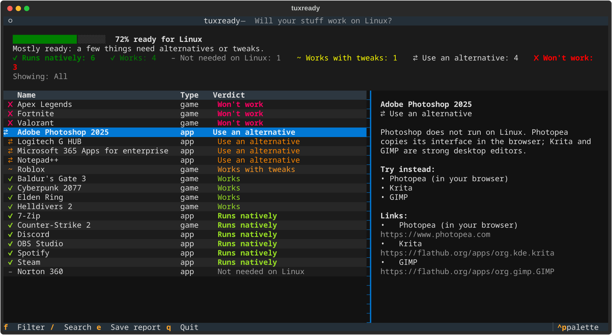

# tuxready 🐧

**Will your apps and games work on Linux? Find out before you switch.**

tuxready scans your Windows PC (installed programs and your Steam library) and tells you,
one by one, what will work on Linux, what won't, and what to use instead.



| You have | tuxready tells you |
|---|---|
| Discord, Spotify, Chrome | ✅ Runs natively, with the install command |
| Elden Ring, Cyberpunk 2077 | ✅ Works through Proton (ProtonDB rating) |
| Valorant, Fortnite, Apex Legends | ❌ Blocked by anti-cheat |
| Photoshop, Microsoft Office | 🔁 Use an alternative: Krita / Photopea, LibreOffice / Office on the web |
| Norton, CCleaner, driver updaters | 💤 Not needed on Linux |

At the end you get a **readiness score** and a report you can save and share.

## Quick start

### On Windows (before switching)

1. Download `tuxready-windows-x64.exe` from the [latest release](https://github.com/Hanocybous/tuxready/releases/latest).
2. Double-click it. That's it: it scans your PC and shows the results.

> Windows SmartScreen may warn about an "unrecognized app" because the file isn't code-signed.
> Click **More info → Run anyway**. You can check the file against `SHA256SUMS.txt` on the release page.

### On Linux (already switched, or checking from a live USB)

```bash
pipx install git+https://github.com/Hanocybous/tuxready   # or download tuxready-linux-x64 from Releases
tuxready "Elden Ring" Photoshop Discord
```

Or point it at the Steam library on your Windows drive:

```bash
tuxready --steam-dir "/run/media/$USER/Windows/Program Files (x86)/Steam"
```

## Usage

```
tuxready                          scan this PC (installed programs + Steam library)
tuxready "Elden Ring" Photoshop   check specific apps or games
tuxready --list my-apps.txt       check a list, one name per line
tuxready --markdown report.md     also save a shareable Markdown report
tuxready --plain                  print a text report instead of the interactive view
tuxready --json                   machine-readable output
tuxready --offline                use cached data only
```

In the interactive view: **↑/↓** browse, **f** filter (problems only, won't work, …),
**/** search, **e** save report, **q** quit.

A list file looks like [`examples/my-apps.txt`](examples/my-apps.txt):

```
Discord
Adobe Photoshop
game: Elden Ring
steam: 1172470
```

## How it decides

| Source | Used for |
|---|---|
| Built-in knowledge base ([`apps.json`](src/tuxready/data/apps.json)) | ~150 common Windows programs: verdict and best Linux alternatives |
| [AreWeAntiCheatYet](https://areweanticheatyet.com) | Whether a game's anti-cheat allows Linux |
| [ProtonDB](https://www.protondb.com) | How well a Windows game runs through Proton |
| Steam store | Native Linux versions, and matching game names to Steam IDs |
| [Flathub](https://flathub.org) | Whether an app is available for Linux |

Anti-cheat that blocks Linux overrides everything else, because a game with a Gold rating is
still unplayable online if the anti-cheat kicks you.

**The score** counts each item: ✅ native/works/not needed = 1, 🔧 tweaks = 0.7,
🔁 alternative = 0.5, ❌ won't work = 0. Unknown items are left out.

Results are cached for a day (`~/.cache/tuxready` or `%LOCALAPPDATA%\tuxready\cache`), so a second run is instant.

## Privacy

tuxready doesn't upload your program list anywhere. It only sends individual app or game
**names** to the public Steam, ProtonDB and Flathub APIs to look them up. There's no telemetry
and no account.

## Contributing

The most useful contribution is **improving the knowledge base**: adding a program people
commonly use, or fixing a verdict that's out of date. It's a single JSON file, so no Python
is needed. See [CONTRIBUTING.md](CONTRIBUTING.md).

Wrong result? [Open an issue](https://github.com/Hanocybous/tuxready/issues) with the name
exactly as tuxready shows it.

## License

MIT. Game data comes from ProtonDB and AreWeAntiCheatYet, which are community projects; please
support them.
